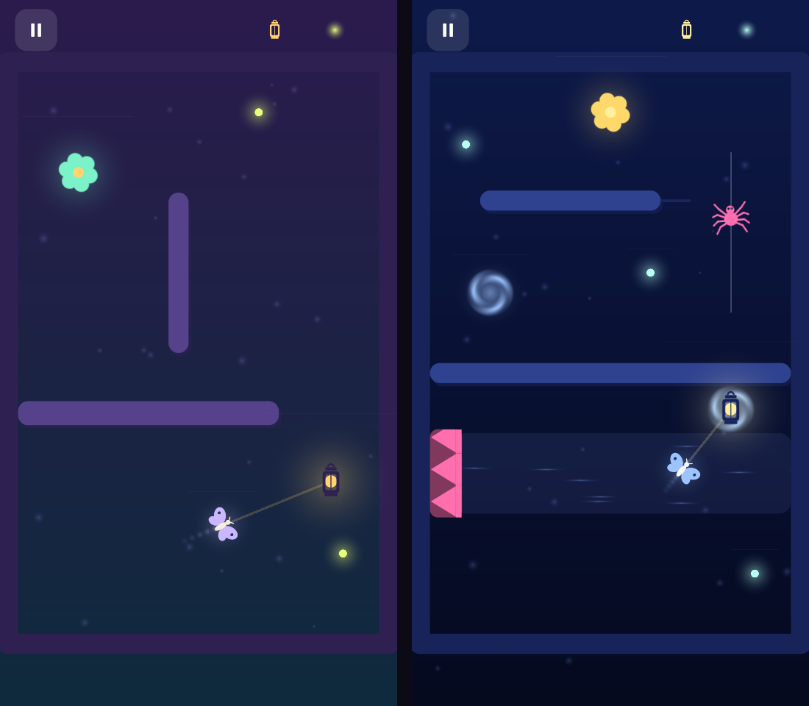

# Glowmoth

*Light the way home.* A small, original, level-based 2D puzzle game for phones, made in Unity.



*Mock-up rendered from the real level data and generated sprites (outside Unity). `atlas-preview.png` shows every generated sprite.*

## The idea

You never touch the moth. **Tap to place a lamp, and the moth flies toward the light, but only while it can see it.**
Walls block light as well as movement, so most puzzles come down to picking spots the moth can see, one after another.
Get the moth into the glowing flower.

- **Hook (under 10 seconds):** tap, and the moth follows the light.
- **Depth:** only one lamp exists at a time. Placing a new one moves it, and the moth needs a clear line of sight to follow.

### 20 levels in 4 worlds

| World | Levels | New idea |
|---|---|---|
| Twilight Garden | 1-5 | tapping the lamp → walls → fireflies → **walls block light** |
| Misty Forest | 6-10 | **thorns** (deadly) → **spiders** on patrol |
| Dusty Attic | 11-15 | **drafts** that push the moth → **sliding shelves** |
| Starlit Sky | 16-20 | **portals** → **candles that burn out** → finale that combines everything |

### Stars (saved locally)
1. Reach the flower.
2. Collect every firefly in the level (free if the level has none).
3. Use no more lamps than the level's par.

Progress (best stars per level) and sound/music settings are saved as JSON in `Application.persistentDataPath`.
Each level unlocks when you finish the previous one.

## Controls

| Action | Touch | Editor |
|---|---|---|
| Place / move the lamp | Tap | Left click |
| Pause | ⏸ button (top left) | ⏸ button or `Esc` |
| Back | Android back button | `Esc` |

## Open, run and build

1. Install **Unity 6 LTS (6000.0.x)** with **Android Build Support**, or iOS support for iPhone, from Unity Hub.
2. In Unity Hub choose **Add → Add project from disk** and select this `Glowmoth` folder. Unity creates `Library/` and the default project settings on the first open, which takes a few minutes.
3. When the project opens, `Glowmoth/Editor/ProjectSetup.cs` configures it automatically. It sets portrait orientation, IL2CPP, ARM64 and high code stripping, and adds `Scenes/Main.unity` to Build Settings. If the console says *"Active Input Handling set to Both"*, restart the editor once.
4. Open `Assets/Glowmoth/Scenes/Main.unity` and press **Play**. Set the Game view to a portrait size such as 1080x1920.
5. To build for Android, use the menu **Glowmoth → Build Android APK**, which writes `Builds/Android/Glowmoth.apk`. You can also use File → Build Profiles → Android → Build.
6. For iOS, switch the platform to iOS in Build Profiles, build, and then open the generated Xcode project.

Menu **Glowmoth → Export Generated Art (PNG)** saves the procedurally drawn sprite atlas as a PNG so you can inspect it.
The game itself never loads it: it draws its art at runtime.

## How it's built (and why it's light)

| Requirement | How |
|---|---|
| **Renderer** | Built-in 2D pipeline with SpriteRenderers. It's lighter than URP for flat sprites: no lights, no post-processing, no HDR or MSAA, and gamma colour space. |
| **Sprite atlas** | `SpriteFactory` draws every sprite (moth, spiders, thorns, flower, lantern, portal, stars, UI icons, panels) from signed-distance shapes into **one 512x512 texture** at startup. World sprites and the UI share it, which keeps draw calls very low. |
| **Object pooling** | `Pool<T>` keeps walls, thorns, spiders, drafts, portals and fireflies between levels. `Fx` is a fixed ring buffer of 160 particle sprites, and `AudioManager` uses 6 pooled audio sources. |
| **Minimal physics** | No Rigidbody or Collider. The moth uses simple steering, and collision is circle-vs-rectangle math (`CollisionMath`). Line of sight is a segment-vs-rectangle slab test. |
| **No per-frame allocations** | All lists are sized up front, there's no LINQ or `foreach` over allocating enumerators, and HUD text changes only when a counter changes, using cached number strings. Coroutines only run on the result screen. |
| **60 FPS** | `Application.targetFrameRate = 60`. The busiest level has roughly 150 sprites in a few batches, and the simulation runs 2 sub-steps per frame over at most about 25 rectangles. |
| **Build size** | No image or audio files. The art is drawn and the sound synthesised at startup (`SfxSynth`, about 0.8 MB of RAM). The package list is minimal (uGUI, audio, JSON), with IL2CPP, ARM64 only and high stripping. Expect an Android build well under the 50 MB target, typically in the 15-25 MB range for Unity 6. |
| **Art style** | Flat, minimal vector shapes drawn as white masks and tinted from one palette per world (`Palettes`). Animation is all in code: wing flaps, lamp flicker and placement pop, flower spin, spider wiggle, swirling portals, flowing drafts, twinkling motes and pop-in stars. |
| **Sound** | Generated at startup: tap, click, pop, collect, win jingle, portal sweep, death, fizzle, plus an 8-second ambient loop that plays in a different key for each world. |

## Project structure

```
Assets/Glowmoth/
  Scenes/Main.unity          Empty bootstrap scene (GameRoot builds everything from code)
  Scripts/
    Core/       GameRoot (entry point and screen flow), GameConfig (tuning), Palette, SaveSystem, Pool
    Art/        SpriteFactory (procedural runtime atlas)
    Audio/      SfxSynth (procedural sounds), AudioManager (voice pool and music)
    Gameplay/   LevelController (simulation and rules), LevelData + LevelDatabase (the 20 levels),
                Entities (pooled "code prefabs": moth, lamp, walls, thorns, spiders, drafts, portals...),
                CollisionMath
    FX/         Fx (pooled particles), Background (gradient and motes)
    UI/         UIKit (uGUI helpers, press/fade/safe-area components), UIManager (all screens)
  Prefabs/      Intentionally empty: see below
  Editor/       ProjectSetup (auto-configuration, art export, one-click Android build)
Packages/manifest.json       Minimal package set
```

**Why there are no prefab or scene assets:** every object is built and pooled by code in `Entities.cs`, which act as prefabs defined in C#.
This keeps the project text-only, easy to diff, and free of broken references. Swapping in hand-made prefabs is straightforward:
each entity class only needs its SpriteRenderers.

### Screens
Main Menu (title, Play, sound and music toggles, total stars, an animated moth demo behind the menu) → Level Select (4 worlds × 5 levels,
with stars and locks) → HUD (pause, level name, lamps used against par, fireflies, a one-time tip) → Pause (resume, restart, levels, audio) →
Win (stars pop in one by one, stats, next, retry and levels) / Lose (reason, retry, levels).

## Making levels

Levels are defined in `LevelDatabase.cs` using a small fluent API (playfield x −4.5..4.5, y −7..7):

```csharp
new LevelData("My Level", par: 3).Moth(0, -5).Home(0, 5)
    .Wall(cx, cy, w, h)                       // static wall (also blocks light)
    .Slider(cx, cy, w, h, dx, dy, period)     // sliding wall
    .Thorn(cx, cy, w, h)                      // deadly strip
    .Spider(ax, ay, bx, by, speed)            // patrols A <-> B
    .Gust(cx, cy, w, h, fx, fy)               // draft pushing with force (fx, fy)
    .Portal(ax, ay, bx, by)                   // two-way teleport
    .Fly(x, y)                                // optional firefly
    .Candles(2.5f)                            // lamps burn out after N seconds
    .Tip("Shown at the start of the level");
```

## Testing status

- **Compiles and builds in Unity 6000.6.5f1** with no script errors, using **Glowmoth → Build Windows (portrait window)**.
- **Recorded from the real build:** `glowmoth-gameplay.mp4` shows levels 1, 4, 8, 13, 14, 16 and 20 auto-played to 3 stars, with no runtime errors.
- **Solver:** the off-line solver, which uses the same movement rules, found 3-star solutions for those levels.
- **Not tested yet:** Android and iOS builds and on-device frame rate. The Android Build Support module isn't installed for this editor yet.

### Recording gameplay yourself
```
Builds/Windows/Glowmoth.exe -glowmothCapture C:\frames -captureLevels 1,4,8
ffmpeg -framerate 30 -i C:\frames\frame_%05d.png -c:v libx264 -pix_fmt yuv420p glowmoth.mp4
```
The capture tool (`Scripts/Dev/AutoPlayCapture.cs`) does nothing in normal play.
